<div align="center">


# MugiManager

**Planifica tus viajes en tren, metro y autobús por Gipuzkoa y Bizkaia.**

Rutas óptimas con transbordos, líneas y paradas, avisos de la red y tu tarjeta MUGI, en la web y en el móvil.

[](https://zer0.is-a.dev/MugiManager/)
[](https://github.com/Zer0Dev-exe/MugiManager/releases/latest)
[](https://mugimanager.vercel.app/api/transport/lines)

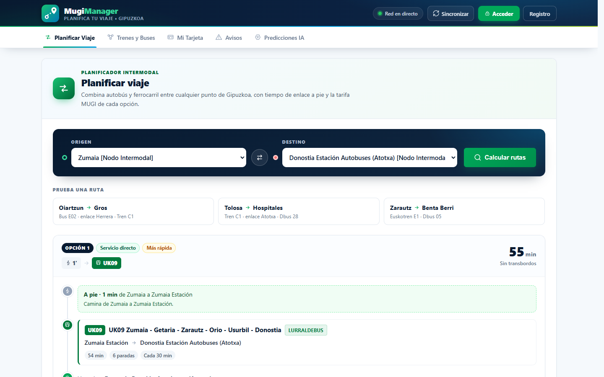

</div>

> [!NOTE]
> **Proyecto independiente.** MugiManager no está afiliado a MUGI, a la Autoridad Territorial del Transporte de Gipuzkoa (ATTG) ni a los operadores. Horarios y tiempos de viaje son orientativos.

## Índice

- [Funcionalidades](#funcionalidades)
- [Instalar la app](#instalar-la-app)
- [Arquitectura](#arquitectura)
- [Desarrollo local](#desarrollo-local)
- [Despliegue](#despliegue)
- [Limitaciones conocidas](#limitaciones-conocidas)

## Funcionalidades

### Planificar viaje

Calcula la ruta más rápida entre dos paradas combinando todos los operadores, con hasta dos transbordos. El tiempo de cada tramo se estima por distancia y velocidad del operador, la espera por la frecuencia de cada línea, y las paradas cercanas (Atotxa tren y bus, Amara y Pío XII, Herrera…) se enlazan a pie. Muestra el desglose de cada opción y el precio con tarjeta MUGI por tramos.

<table>
  <tr>
    <th width="68%">Escritorio</th>
    <th width="32%">Móvil</th>
  </tr>
  <tr>
    <td>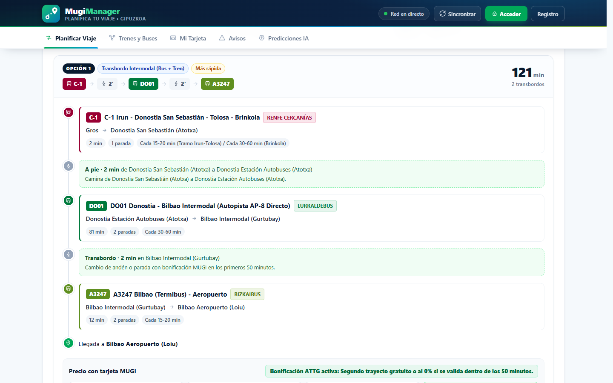</td>
    <td>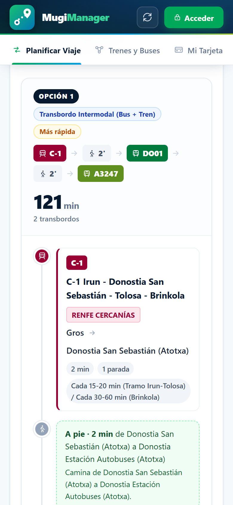</td>
  </tr>
</table>

### Trenes y buses

Catálogo de líneas con frecuencias, horarios y cabeceras; buscador de paradas con dirección, mapa y enlaces a Google Maps; filtros por operador.

<table>
  <tr>
    <th width="68%">Escritorio</th>
    <th width="32%">Móvil</th>
  </tr>
  <tr>
    <td>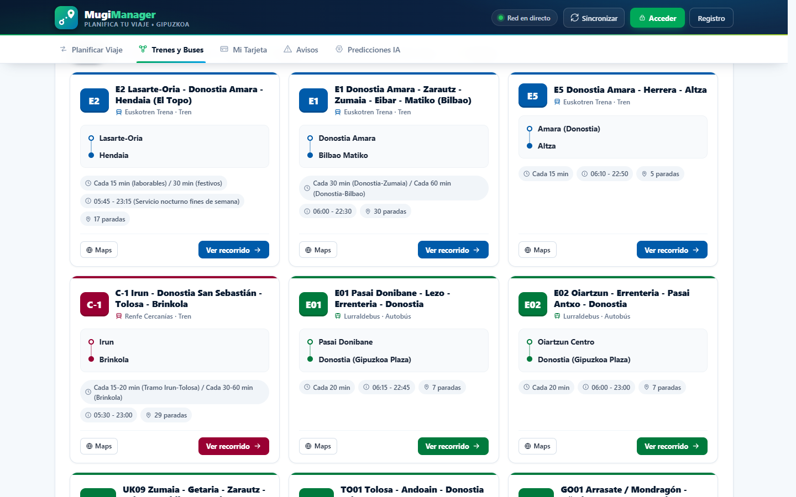</td>
    <td>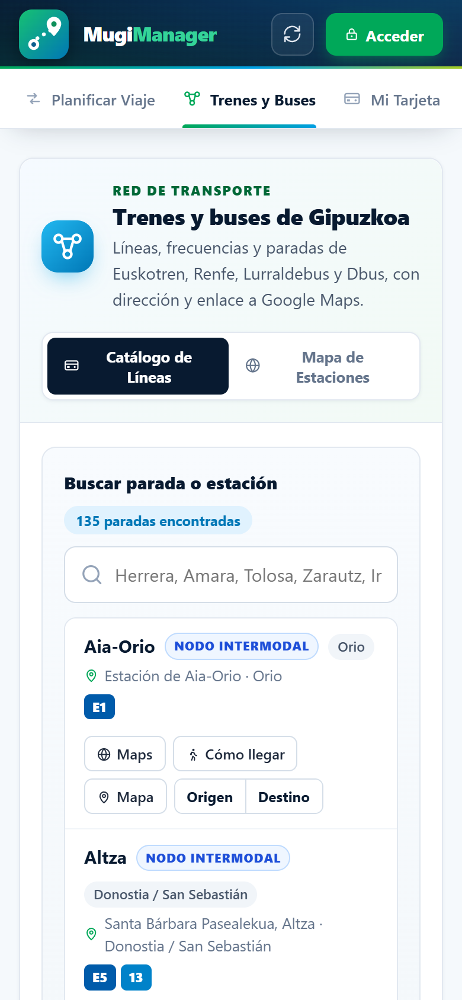</td>
  </tr>
</table>

**Operadores incluidos:** Euskotren (E1 hasta Bilbao, E2 Topo, E5), Renfe Cercanías C-1, Lurraldebus, Dbus, Metro Bilbao (L1 y L2) y Bizkaibus (aeropuerto).

### Avisos de la red

Incidencias activas filtrables por comarca, comunicados y tablas de tarifas obtenidos de la web pública mugi.eus.

<table>
  <tr>
    <th width="68%">Escritorio</th>
    <th width="32%">Móvil</th>
  </tr>
  <tr>
    <td>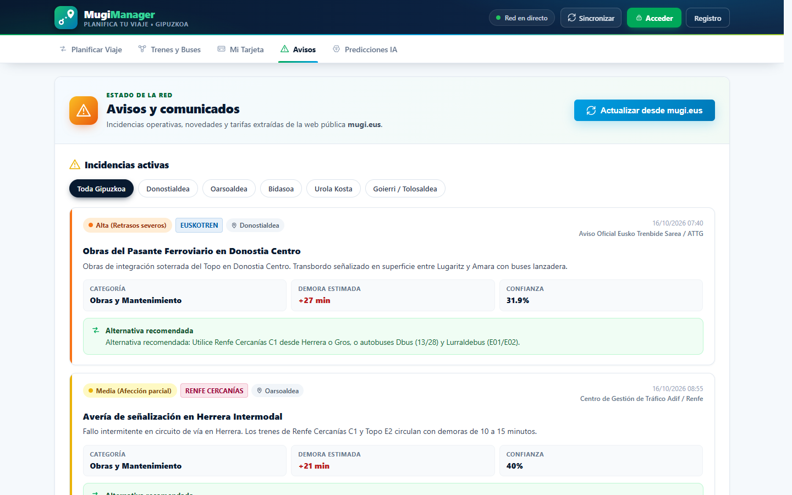</td>
    <td>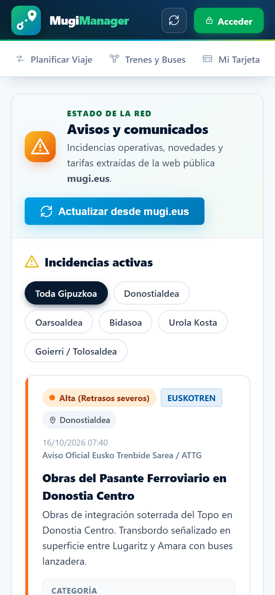</td>
  </tr>
</table>

### Predicciones IA

Modelo de scikit-learn (TF-IDF, regresión logística y Ridge) que, a partir del texto de un aviso, predice la severidad, la categoría, la zona, el operador afectado y la demora estimada, y propone una alternativa de transporte.

<table>
  <tr>
    <th width="68%">Escritorio</th>
    <th width="32%">Móvil</th>
  </tr>
  <tr>
    <td>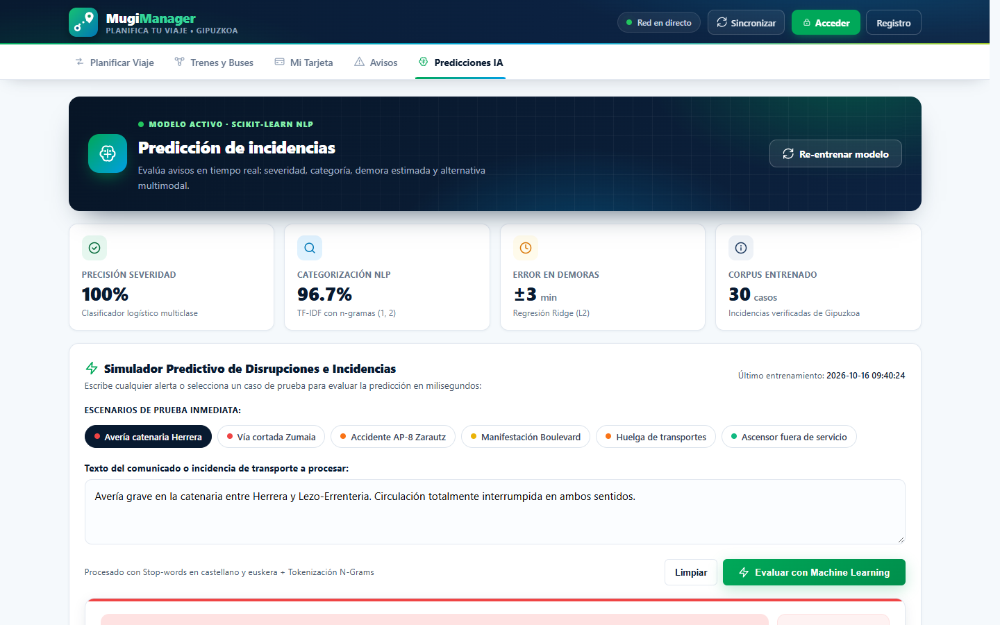</td>
    <td>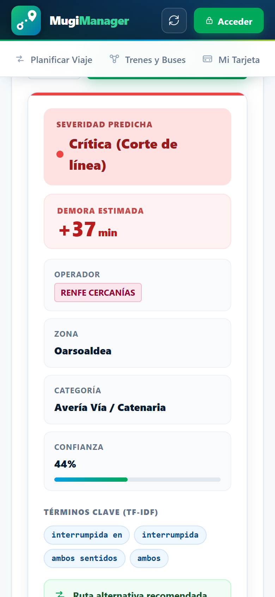</td>
  </tr>
</table>

### Mi tarjeta

Saldo, tramo de descuento ATTG e historial de viajes. Solo se muestra tras iniciar sesión, y cada usuario accede únicamente a su propia tarjeta.

<table>
  <tr>
    <th width="68%">Escritorio</th>
    <th width="32%">Móvil</th>
  </tr>
  <tr>
    <td>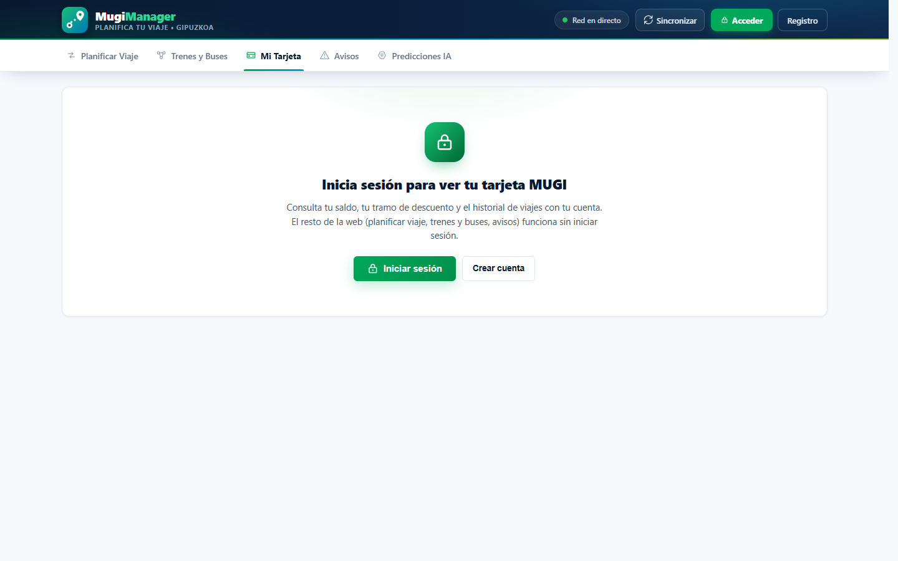</td>
    <td>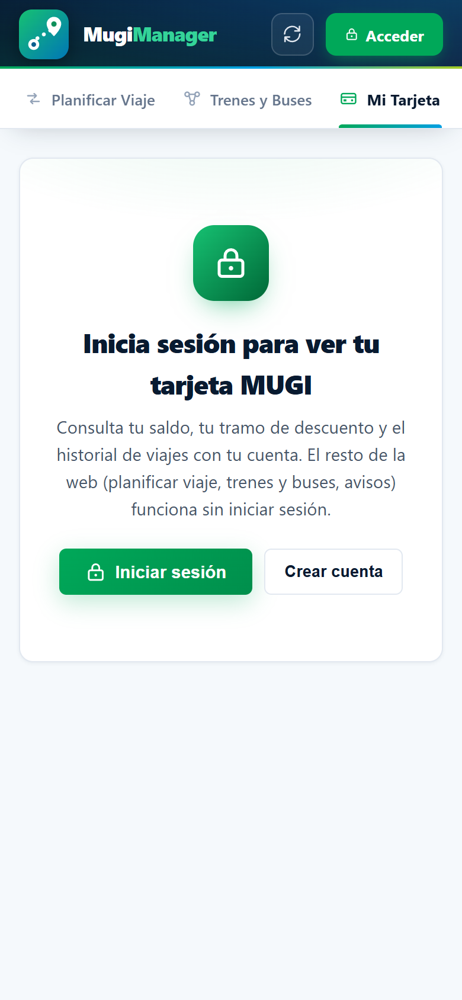</td>
  </tr>
</table>

## Instalar la app

| Plataforma | Cómo |
|---|---|
| **Android (APK)** | Descarga `MugiManager-vX.Y.Z.apk` desde [Releases](https://github.com/Zer0Dev-exe/MugiManager/releases/latest) y permite instalar apps de origen desconocido. |
| **Android (PWA)** | Abre la [web](https://zer0.is-a.dev/MugiManager/) en Chrome → menú → *Instalar aplicación*. |
| **iPhone / iPad** | Abre la [web](https://zer0.is-a.dev/MugiManager/) en Safari → *Compartir* → *Añadir a pantalla de inicio*. |
| **Escritorio** | Abre la [web](https://zer0.is-a.dev/MugiManager/) en Chrome o Edge → icono de instalar en la barra de direcciones. |

## Arquitectura

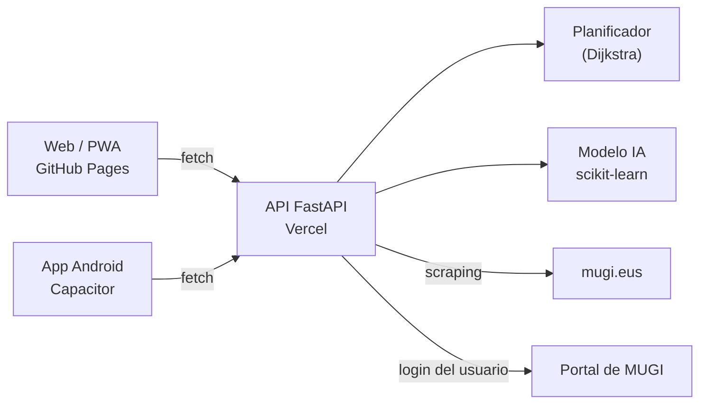

| Parte | Dónde | Código |
|---|---|---|
| Web / PWA | GitHub Pages | `frontend/`: HTML, CSS y JavaScript sin compilación, con service worker y manifest |
| App Android | APK en las releases | Capacitor sobre `frontend/` (`capacitor.config.json`) |
| API | Vercel (Python) | `backend/` (FastAPI), entrada en `main.py` |

La URL de la API que usan la web y la app está en [`frontend/js/config.js`](frontend/js/config.js).

```
├── backend/                   API FastAPI
│   ├── main.py                Endpoints
│   ├── transport_service.py   Red de transporte y planificador
│   ├── ml_incident_model.py   Modelo de predicción de incidencias
│   ├── auth_service.py        Cuentas y tokens de sesión firmados
│   └── scraper_service.py     Avisos y tarifas de mugi.eus
├── frontend/                  Web / PWA (también es el contenido de la app Android)
├── assets/                    Icono y pantalla de inicio de Android
├── docs/screenshots/          Capturas del README
└── .github/workflows/         Despliegue en Pages y release con APK
```

## Desarrollo local

Requisitos: Python 3.10 o superior.

```bash
python -m venv .venv
.venv/Scripts/pip install -r requirements.txt   # Linux/macOS: .venv/bin/pip
python main.py
```

Abre http://127.0.0.1:8000. En local el propio backend sirve la web y la app usa la API local.

Para generar el proyecto Android (requiere Node.js; para compilar, también Java 21 y el SDK de Android):

```bash
npm install
npm run android:add && npm run android:icons && npm run android:sync
cd android && ./gradlew assembleDebug
```

## Despliegue

| Qué | Cuándo | Cómo |
|---|---|---|
| **Web** | Cada push a `main` que toca `frontend/` | [`pages.yml`](.github/workflows/pages.yml) publica en GitHub Pages |
| **API** | Manual | `vercel deploy --prod` desde la raíz. Requiere la variable `MUGI_SECRET`, que firma los tokens de sesión |
| **Release** | Al subir una etiqueta `vX.Y.Z` | [`release.yml`](.github/workflows/release.yml) compila el APK y lo publica junto a un zip de la web |

```bash
git tag -a v1.1.0 -m "MugiManager v1.1.0" && git push origin v1.1.0
```

## Limitaciones conocidas

- En Vercel las cuentas se guardan en `/tmp`, que no es persistente ni se comparte entre instancias. Las cuentas sincronizadas con el portal de MUGI se recrean al iniciar sesión, pero las registradas a mano pueden perderse. Para que sean persistentes hace falta una base de datos (por ejemplo Upstash Redis o Vercel Postgres).
- La primera petición tras un rato sin uso tarda unos segundos mientras Vercel arranca la función.
- El APK se firma con la clave de depuración. Para publicarlo en Google Play hay que firmarlo con una clave propia.
- Las coordenadas de algunas paradas y los tiempos de viaje son aproximados.
